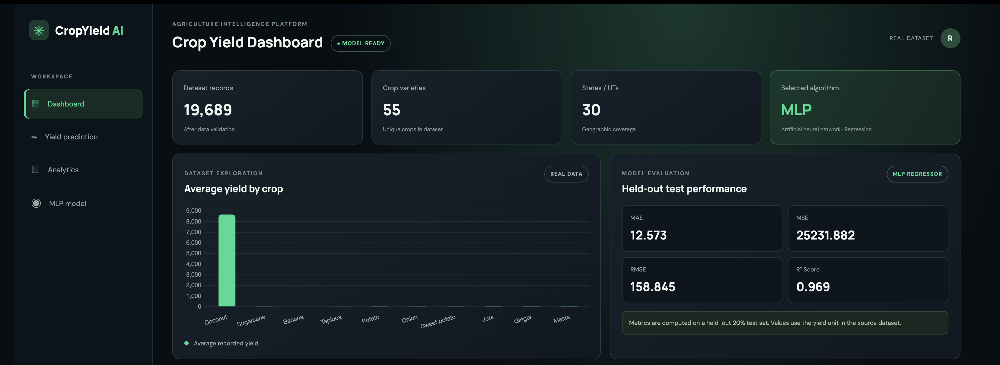
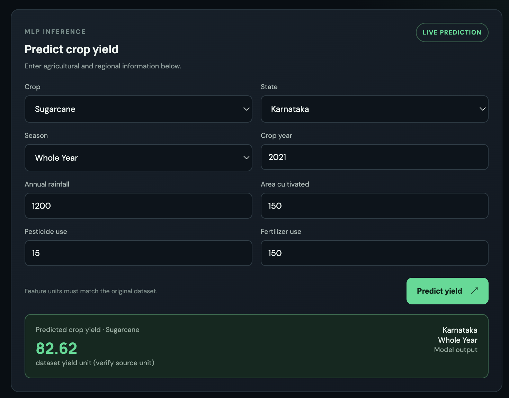
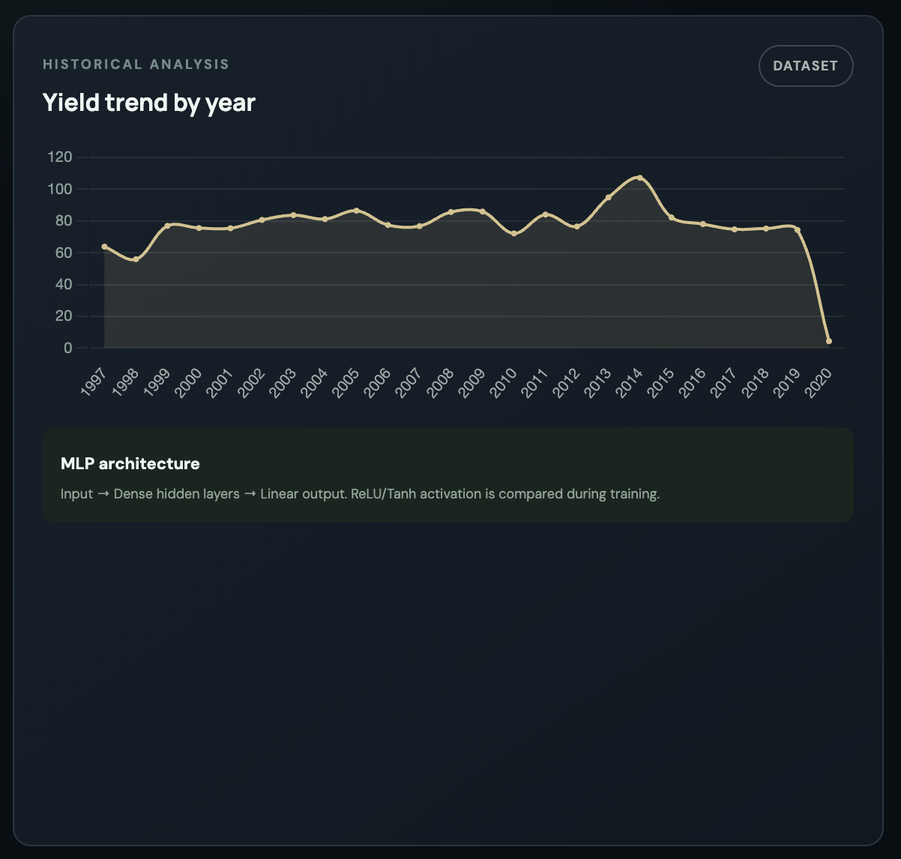
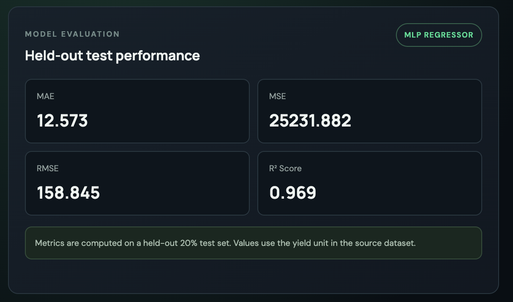

# 🌾 Crop Yield Predictor

**Crop Yield Prediction Using Multilayer Perceptron (MLP)**

An AI-powered agricultural prediction system that uses Machine Learning and an Artificial Neural Network (MLP Regressor) to predict crop yield based on historical agricultural data and farming-related parameters.

The project features an interactive Flask dashboard for crop yield prediction, dataset exploration, historical analysis and machine learning model evaluation.

---

## 📸 Screenshots

### 1. Main Dashboard



### 2. Crop Yield Prediction



### 3. Dataset Analytics



### 4. MLP Model Evaluation



---

## ✨ Features

- **Crop Yield Prediction:** Predict crop yield using agricultural and environmental parameters.
- **MLP Regression:** Artificial Neural Network-based regression using Scikit-learn.
- **Dataset Exploration:** Visualize average recorded yield across different crops.
- **Historical Analysis:** Explore yearly crop yield trends.
- **Model Evaluation:** Evaluate performance using MAE, MSE, RMSE and R² score.
- **MLP Experiments:** Compare different neural network configurations and activation functions.
- **Interactive Dashboard:** Modern dark-themed dashboard built using Flask, HTML, CSS and JavaScript.

---

## 🛠️ Tech Stack

| Category | Technologies |
|---|---|
| Programming Language | Python |
| Machine Learning | Scikit-learn, MLPRegressor |
| Data Processing | Pandas, NumPy |
| Backend | Flask |
| Frontend | HTML, CSS, JavaScript |
| Visualization | Chart.js |
| Model Evaluation | MAE, MSE, RMSE, R² |

---

## 📂 Project Structure

```text
Crop-Yield-Predictor/
│
├── data/
│   ├── crop_yield.csv
│   └── README.md
│
├── models/
│   └── Trained model and preprocessing files
│
├── reports/
│   └── Experiment and evaluation reports
│
├── src/
│   └── Machine learning source modules
│
├── static/
│   ├── css/
│   └── js/
│
├── templates/
│   └── HTML templates
│
├── screenshots/
│   ├── dashboard.png
│   ├── yield-prediction.png
│   ├── analytics.png
│   └── mlp-evaluation.png
│
├── app.py
├── train.py
├── download_dataset.py
├── requirements.txt
├── .gitignore
└── README.md
```

---

## 📊 Dataset

The project uses an agricultural crop yield dataset containing **19,689 records**.

The dataset includes the following attributes:

- Crop
- State
- Season
- Crop Year
- Annual Rainfall
- Area Cultivated
- Pesticide Usage
- Fertilizer Usage
- Crop Yield

**Dataset Source:** [Crop Yield Dataset](https://github.com/atharv-sh/crop_yield_dataset)

The dataset can be downloaded using the included Python script.

```bash
python download_dataset.py
```

---

## 🧠 Machine Learning Approach

The project uses a **Multilayer Perceptron (MLP) Regressor**, a type of Artificial Neural Network used for predicting continuous numerical values.

### Model Development Workflow

1. Dataset loading and exploration.
2. Data preprocessing and handling missing values.
3. Encoding categorical features.
4. Feature scaling and normalization.
5. Training and testing data split.
6. MLP architecture selection.
7. Model training using backpropagation.
8. Model performance evaluation.

### MLP Architecture

**Selected Model: MLP-100-50-ReLU**

| Component | Configuration |
|---|---|
| Input Layer | Preprocessed agricultural features |
| Hidden Layer 1 | 100 neurons |
| Hidden Layer 2 | 50 neurons |
| Activation Function | ReLU |
| Output Layer | Linear output |
| Model Type | Regression |

---

## 📈 Model Performance

The selected MLP model achieved the following results on the held-out test dataset:

| Evaluation Metric | Result |
|---|---:|
| MAE | 12.573 |
| MSE | 25,231.882 |
| RMSE | 158.845 |
| R² Score | 0.9685 |

### Understanding the Metrics

- **MAE:** Measures the average absolute difference between actual and predicted values.
- **MSE:** Measures the average squared prediction error.
- **RMSE:** Measures prediction error while penalizing larger errors.
- **R² Score:** Indicates how much variation in the target variable is explained by the model.

*Note: These are results from the current training run. Metrics may change when the dataset or model configuration changes.*

---

## ⚙️ Installation and Setup

Follow these steps to run the project locally.

### 1. Clone the Repository

```bash
git clone https://github.com/Rohan26096/Crop-Yield-Predictor.git
```

```bash
cd Crop-Yield-Predictor
```

### 2. Create a Virtual Environment

```bash
python3 -m venv .venv
```

### 3. Activate the Virtual Environment

**macOS / Linux**

```bash
source .venv/bin/activate
```

**Windows**

```bash
.venv\Scripts\activate
```

### 4. Install Dependencies

```bash
pip install -r requirements.txt
```

### 5. Download the Dataset

```bash
python download_dataset.py
```

### 6. Train the MLP Model

```bash
python train.py
```

### 7. Run the Flask Application

```bash
python app.py
```

Open the application in your browser:

```text
http://127.0.0.1:5000
```

---

## 🔮 Future Improvements

- Improve model performance through hyperparameter tuning.
- Experiment with additional regression algorithms.
- Incorporate more agricultural and environmental parameters.
- Improve data visualization and analytics.
- Integrate real-time weather information.
- Expand the dataset with additional crop varieties and regions.

---

## 🎓 Academic Project

| Details | Information |
|---|---|
| Project Title | Crop Yield Prediction Using MLP |
| Domain | Agriculture / Machine Learning |
| Algorithm | Multilayer Perceptron Regressor |
| Framework | Flask |
| Programming Language | Python |
| Project Type | Academic Mini Project |

---

## 👨‍💻 Author

**Rohan**

GitHub: [@Rohan26096](https://github.com/Rohan26096)

**Repository:** [Crop-Yield-Predictor](https://github.com/Rohan26096/Crop-Yield-Predictor)

---

*Developed as an academic mini project using Machine Learning and Artificial Neural Networks.*